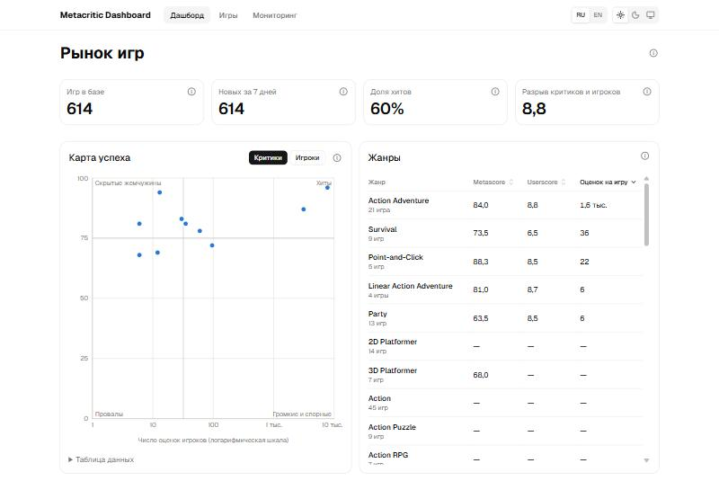
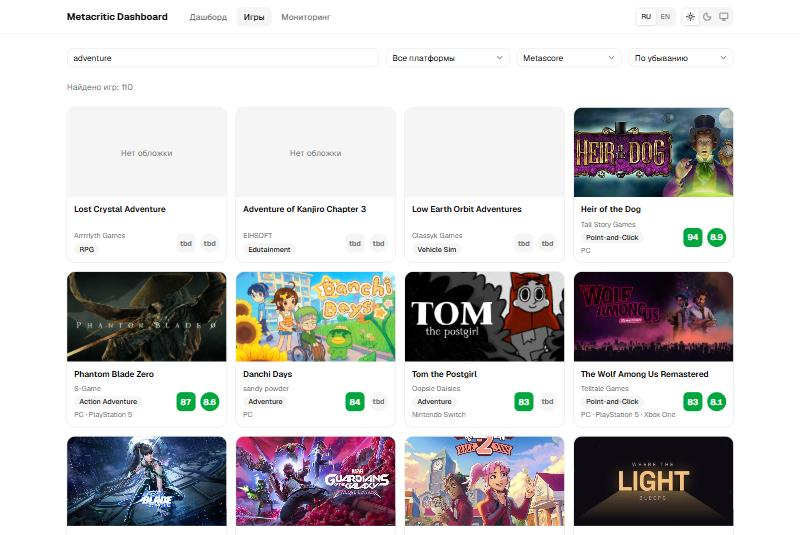
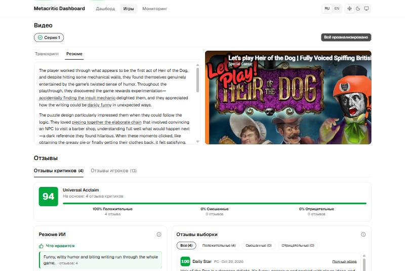

# Metacritic Dashboard

Сервис раз в час собирает с Metacritic новые игры, складывает их в SQLite, строит по отзывам резюме с помощью языковой модели и показывает всё в веб-интерфейсе. К игре подбираются видео с YouTube, по ним строятся транскрипт и резюме со ссылками на таймкоды, а состояние сервиса можно смотреть в реальном времени.

**Работающий сервис:** <http://31.56.179.84> · **Репозиторий:** <https://github.com/BuDum-Tss/metacritic_dashboard>



| Список игр | Карточка игры: видео и резюме |
|---|---|
|  |  |

## Что умеет

**Сбор данных.** Раз в час обход берёт новые игры: в первый запуск дня из раздела New Releases, дальше из «SEE ALL». Для каждой игры забираются название, обложка, разработчик, описание, трейлер, платформы с Metascore и Userscore, жанры и дата релиза. Молодые игры (до 30 дней) обновляются раз в сутки, остальные раз в неделю; изменения хранятся в истории.

**Резюме по отзывам.** Модель читает тексты отзывов критиков и игроков (не оценки) и выделяет, что нравится и что не нравится. Каждый пункт связан с отзывами, на которых он основан: клик по пункту оставляет в списке только их. Токены тратятся, только когда выборка отзывов изменилась.

**Веб-интерфейс.**
- Список игр: поиск по названию, жанру, разработчику и описанию, фильтр по платформе, сортировка по рейтингу, пагинация.
- Карточка игры: все данные, оценки по платформам, общие оценки Metacritic, слайдер обложки, трейлера и видео, отзывы с резюме, похожие игры (по жанрам и платформам).
- Дашборд рынка: показатели, карта успеха (внимание против оценки), жанры, где критики и игроки расходятся, ритм релизов.
- Мониторинг: состояние трёх конвейеров, ближайший запуск, журнал запусков с играми каждого запуска и кнопка принудительного запуска.
- Русский и английский язык, светлая и тёмная тема (настройки в шапке справа).

**Видео с YouTube (доп. часть 1).**
- Для игры ищутся самый популярный летсплей и обзор на английском. Летсплеи без комментариев и игрофильмы отбрасываются. Многосерийный летсплей сохраняется плейлистом.
- По кнопке «Проанализировать все» для каждой серии строится транскрипт с таймкодами: сначала субтитры YouTube, а если их нет, распознавание речи через OpenRouter (Whisper). Клик по таймкоду перематывает плеер.
- По транскрипту модель выделяет яркие моменты, где автор столкнулся с проблемой или отреагировал положительно, и пишет резюме со ссылками на таймкоды (слова-ссылки перематывают видео).

## Как задание закрыто

| Часть задания | Где |
|---|---|
| Раз в час берём игры, SQLite | обход (`backend/app/services/crawl.py`), APScheduler |
| Данные игры, платформы и оценки, резюме отзывов | Metacritic-парсер `backend/app/sources/metacritic/`, `services/summaries.py` |
| Веб-интерфейс: список, карточка, фильтр, поиск, сортировка, похожие игры | `frontend/src/pages/` |
| Доп. часть 1: летсплей, текст, заключение | `backend/app/videos/`, `app/transcripts/`, `services/transcripts.py`, `services/video_summary.py` |
| Доп. часть 2: мониторинг и кнопка запуска | страница «Мониторинг», `backend/app/api/sync.py` |

Требования с идентификаторами лежат в [docs/REQUIREMENTS.md](docs/REQUIREMENTS.md).

## Устройство

```
Metacritic ──► обход ───────────► SQLite ◄── анализ отзывов ◄── LLM
                                     ▲
YouTube ──► поиск видео ─────────────┤
              │                      │
              └─► транскрипт ─► резюме видео (по кнопке)
                                     │
                              FastAPI /api ──► React-интерфейс
```

- **Три независимых конвейера** со своими расписанием, лимитом, блокировкой и журналом: обход игр, анализ отзывов, поиск видео. Транскрипт и резюме видео запускаются по запросу со страницы игры: часовой летсплей слишком дорого обрабатывать для всех игр.
- **Один процесс**: FastAPI и планировщик APScheduler живут вместе, потому что у SQLite один писатель.
- **Источник данных абстрагирован** (`GameSource`): сейчас Metacritic, позже можно добавить Steam.
- Подробное описание решений, таблиц и API: [docs/ARCHITECTURE.md](docs/ARCHITECTURE.md), [docs/DATABASE.md](docs/DATABASE.md).

Стек: Python, FastAPI, SQLAlchemy 2, Alembic, Pydantic, BeautifulSoup, APScheduler, SQLite; React 19, TypeScript, Vite, Tailwind CSS, shadcn/ui, TanStack Query, Recharts; Docker Compose и Caddy на VPS, GitHub Actions.

## Запуск локально

Нужны Python 3.11+ и актуальный Node (22 LTS).

```bash
# бэкенд
cd backend
python -m venv .venv
.venv/bin/pip install -e ".[dev]"      # на Windows: .venv\Scripts\pip
cp .env.example .env                    # при необходимости впишите ключи
.venv/bin/uvicorn app.main:app --reload  # http://localhost:8000, документация на /docs

# фронтенд (в другом терминале)
cd frontend
npm install
npm run dev                             # http://localhost:5173, /api проксируется на :8000
```

Миграции базы применяются при старте. Без ключей сервис работает: резюме и видео просто выключены, в мониторинге видно «не настроен».

| Переменная | Зачем |
|---|---|
| `LLM_API_KEY` (`LLM_BASE_URL`, `LLM_MODEL`) | резюме отзывов и резюме видео, любой OpenAI-совместимый API |
| `YOUTUBE_API_KEY` | поиск видео (YouTube Data API v3) |
| `OPENROUTER_API_KEY` | распознавание речи, если у видео нет субтитров (нужен ещё `ffmpeg`) |

Остальные настройки (лимиты, интервалы, пороги) описаны в [backend/.env.example](backend/.env.example).

Проверки:

```bash
cd backend && .venv/bin/python -m pytest      # 300+ тестов
cd frontend && npm run lint && npm run build
```

## Развёртывание

`docker compose up -d` поднимает бэкенд и Caddy с собранным фронтендом (порты 80 и 443, адрес сайта через `SITE_ADDRESS`). База лежит в томе `/data`. Деплой автоматический: push в `main` запускает GitHub Actions (тесты, сборка образов в GHCR, обновление на сервере по SSH). Подробности и список секретов: раздел «Деплой» в [docs/ARCHITECTURE.md](docs/ARCHITECTURE.md).

## Структура

```
backend/app/
  sources/      источник данных (Metacritic) за интерфейсом GameSource
  services/     обход, анализ отзывов, видео, транскрипты, резюме видео
  videos/       клиент YouTube и правила выбора ролика
  transcripts/  субтитры YouTube и распознавание речи
  db/           модели, миграции Alembic, репозитории и запросы
  api/          HTTP API (/api/games, /api/dashboard, /api/sync)
frontend/src/   страницы, компоненты, словари ru/en
docs/           требования, архитектура, схема БД, скриншоты
```

## Как велась разработка

Проект сделан вместе с ИИ-агентом (Claude Code). Правила работы агента описаны в [AGENTS.md](AGENTS.md): сначала обновляется архитектура ([docs/ARCHITECTURE.md](docs/ARCHITECTURE.md)), потом пишется код, а все значимые изменения попадают в [CHANGELOG.md](CHANGELOG.md). Постановка задачи: [TASK.md](TASK.md). Полная переписка с агентом приложена к сдаче отдельно.

## Известные ограничения

- Metascore и Userscore у новинок появляются только после выхода рецензий, поэтому у многих свежих игр оценок ещё нет и в таблицах стоят прочерки.
- YouTube часто блокирует получение субтитров с адресов дата-центров. Тогда транскрипт берётся распознаванием речи, если задан `OPENROUTER_API_KEY`. Бесплатная квота YouTube Data API (10 000 единиц в сутки) позволяет искать видео примерно для 30–40 игр в сутки, поэтому поиск идёт сначала по самым популярным играм.
- Распознавание речи платное (около 3 центов за час звука), поэтому есть лимиты на длину видео и на объём за один запрос.
