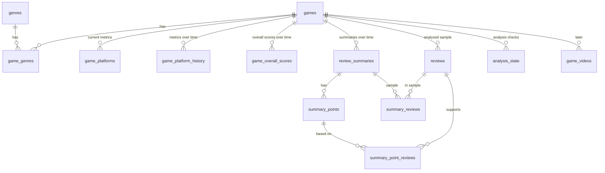

# Схема базы данных

СУБД: SQLite. Общие решения по хранению описаны в [ARCHITECTURE.md](ARCHITECTURE.md).

Принципы:
- Время хранится в UTC в формате ISO 8601 (`TEXT`).
- Хранятся только отзывы, вошедшие в выборку для резюме (не больше 70 на игру); остальные отзывы можно получить с Metacritic.
- Метрики и резюме версионируются: строки только добавляются, чтобы строить графики во времени.
- Актуальные значения для списка, фильтров и сортировки лежат в `game_platforms`.

## Диаграмма связей

`sync_runs` с игровыми таблицами не связана внешними ключами, это журнал запусков; `run_games` хранит игры, обработанные в запуске.

## Таблицы

### `games`

Одна строка на игру, актуальные описательные данные.

| Поле | Тип | Описание |
|---|---|---|
| `id` | INTEGER PK | |
| `source` | TEXT NOT NULL | источник данных: `metacritic`, позже `steam` |
| `slug` | TEXT NOT NULL | идентификатор игры у источника (для Metacritic — из URL) |
| `url` | TEXT NOT NULL | ссылка на страницу игры |
| `title` | TEXT NOT NULL | название |
| `cover_url` | TEXT | картинка-обложка |
| `developer` | TEXT | разработчик |
| `description` | TEXT | описание |
| `video_url` | TEXT | ссылка на видео |
| `content_hash` | TEXT | хэш описательных полей (название, обложка, разработчик, описание, видео, жанры) |
| `release_date` | TEXT | дата релиза игры (`YYYY-MM-DD`, из страницы игры), `NULL` пока неизвестна |
| `first_seen_at` | TEXT NOT NULL | когда игра впервые попала в базу |
| `updated_at` | TEXT NOT NULL | когда описательные поля менялись в последний раз |
| `last_processed_at` | TEXT NOT NULL | когда игра обрабатывалась в последний раз |
| `next_check_at` | TEXT NOT NULL | когда игру пора проверить в следующий раз (расписание повторных визитов) |

Индексы: `(source, slug)` (уникальный), `last_processed_at`, `next_check_at` (выбор игр, которые пора проверить), `release_date` (сортировка и ритм релизов на дашборде).

### `genres`

| Поле | Тип | Описание |
|---|---|---|
| `id` | INTEGER PK | |
| `name` | TEXT UNIQUE NOT NULL | |

### `game_genres`

| Поле | Тип | Описание |
|---|---|---|
| `game_id` | INTEGER FK → games.id | |
| `genre_id` | INTEGER FK → genres.id | |

Первичный ключ: `(game_id, genre_id)`.

### `game_platforms`

Актуальные значения по платформам.

| Поле | Тип | Описание |
|---|---|---|
| `game_id` | INTEGER FK → games.id | |
| `platform` | TEXT NOT NULL | например `ps5`, `switch-2` |
| `metascore` | INTEGER | оценка критиков, `NULL` если нет |
| `userscore` | REAL | оценка пользователей, `NULL` если нет |
| `critic_reviews_count` | INTEGER | |
| `user_reviews_count` | INTEGER | |
| `updated_at` | TEXT NOT NULL | |

Первичный ключ: `(game_id, platform)`. Индекс по `platform` для фильтра.

### `game_platform_history`

История метрик. Только добавление строк, по одной на платформу при каждом обходе.

| Поле | Тип | Описание |
|---|---|---|
| `id` | INTEGER PK | |
| `game_id` | INTEGER FK → games.id | |
| `platform` | TEXT NOT NULL | |
| `metascore` | INTEGER | |
| `userscore` | REAL | |
| `critic_reviews_count` | INTEGER | |
| `user_reviews_count` | INTEGER | |
| `captured_at` | TEXT NOT NULL | |

Индекс: `(game_id, platform, captured_at)`.

### `game_overall_scores`

Общие оценки игры так, как их показывает Metacritic в шапке страницы игры. Только добавление строк: при каждой обработке игры по строке для критиков и для игроков. Актуальная — самая свежая строка по `(game_id, source)`.

| Поле | Тип | Описание |
|---|---|---|
| `id` | INTEGER PK | |
| `game_id` | INTEGER FK → games.id | |
| `source` | TEXT NOT NULL | `critics` или `users` |
| `score` | REAL | Metascore (0–100) или Userscore (0–10), `NULL` если оценки ещё нет |
| `verdict` | TEXT | вердикт, например `Generally Favorable`; `NULL` если оценки нет |
| `reviews_count` | INTEGER | число отзывов или оценок |
| `positive` | INTEGER | число положительных отзывов |
| `mixed` | INTEGER | число смешанных |
| `negative` | INTEGER | число отрицательных |
| `captured_at` | TEXT NOT NULL | |

Индекс: `(game_id, source, captured_at)`.

### `reviews`

Отзывы, вошедшие в выборку для резюме. Строка создаётся один раз и переиспользуется в следующих резюме.

| Поле | Тип | Описание |
|---|---|---|
| `id` | INTEGER PK | |
| `game_id` | INTEGER FK → games.id | |
| `source` | TEXT NOT NULL | `critics` или `users` |
| `external_key` | TEXT NOT NULL | `sha256` от `(тип, автор, дата, оценка, текст)`: на странице Metacritic идентификатора нет |
| `platform` | TEXT | слаг платформы, с которой взят отзыв |
| `author` | TEXT | издание (критики) или имя пользователя |
| `score` | INTEGER | оценка (критики 0–100, пользователи 0–10) |
| `reviewed_at` | TEXT | дата отзыва |
| `text` | TEXT NOT NULL | текст отзыва |
| `url` | TEXT | ссылка на полный обзор (у критиков) |
| `first_seen_at` | TEXT NOT NULL | |

Уникальный ключ: `(game_id, source, external_key)`.

### `review_summaries`

Версии резюме по отзывам. Только добавление строк. Новая версия создаётся при смене `reviews_hash`, но не чаще раза в сутки.

| Поле | Тип | Описание |
|---|---|---|
| `id` | INTEGER PK | |
| `game_id` | INTEGER FK → games.id | |
| `source` | TEXT NOT NULL | `critics` или `users` |
| `reviews_hash` | TEXT NOT NULL | хэш ключей отзывов выборки |
| `sample_size` | INTEGER NOT NULL | сколько отзывов проанализировано |
| `total_reviews` | INTEGER | сколько отзывов этого типа всего у игры |
| `model` | TEXT NOT NULL | какая модель сделала резюме |
| `generated_at` | TEXT NOT NULL | |

Индекс: `(game_id, source, generated_at)`. Актуальное резюме — самая свежая строка по `(game_id, source)`.

### `summary_reviews`

Вся выборка отзывов, на которой построено резюме (пункты ссылаются на её часть через `summary_point_reviews`).

| Поле | Тип | Описание |
|---|---|---|
| `summary_id` | INTEGER FK → review_summaries.id | |
| `review_id` | INTEGER FK → reviews.id | |

Первичный ключ: `(summary_id, review_id)`.

### `summary_points`

Пункты резюме.

| Поле | Тип | Описание |
|---|---|---|
| `id` | INTEGER PK | |
| `summary_id` | INTEGER FK → review_summaries.id | |
| `kind` | TEXT NOT NULL | `like` или `dislike` |
| `position` | INTEGER NOT NULL | порядок внутри резюме |
| `text` | TEXT NOT NULL | формулировка пункта |

### `summary_point_reviews`

Связь пункта с отзывами, на которых он основан.

| Поле | Тип | Описание |
|---|---|---|
| `point_id` | INTEGER FK → summary_points.id | |
| `review_id` | INTEGER FK → reviews.id | |

Первичный ключ: `(point_id, review_id)`.

### `analysis_state`

Когда последний раз проверяли отзывы игры и сколько их тогда было. По нему анализ не возвращает в очередь игру, у которой число отзывов не изменилось.

| Поле | Тип | Описание |
|---|---|---|
| `game_id` | INTEGER FK → games.id | |
| `kind` | TEXT NOT NULL | `critics` или `users` |
| `checked_at` | TEXT NOT NULL | когда проверка была завершена |
| `total_reviews` | INTEGER NOT NULL | сколько отзывов этого типа было у игры при проверке |

Первичный ключ: `(game_id, kind)`; строка обновляется при каждой проверке.

### `sync_runs`

Журнал запусков обоих конвейеров. Из него берутся данные для мониторинга.

| Поле | Тип | Описание |
|---|---|---|
| `id` | INTEGER PK | |
| `pipeline` | TEXT NOT NULL | конвейер: `crawl` (обход) или `analysis` (анализ отзывов) |
| `trigger` | TEXT NOT NULL | `schedule` или `manual` |
| `status` | TEXT NOT NULL | `running`, `success`, `failed` |
| `source` | TEXT NOT NULL | источник данных: `metacritic` |
| `batch_index` | INTEGER NOT NULL | порядковый номер успешного запуска источника за день, начиная с 0 (справочно) |
| `started_at` | TEXT NOT NULL | |
| `finished_at` | TEXT | |
| `games_found` | INTEGER | |
| `games_processed` | INTEGER | |
| `games_failed` | INTEGER | |
| `error` | TEXT | |

### `run_games`

Игры, обработанные в запуске конвейера, с итогом. Строка пишется сразу после обработки игры, поэтому список виден по ходу запуска. Хранится название на момент записи: игра могла не попасть в базу (ошибка загрузки новой игры).

| Поле | Тип | Описание |
|---|---|---|
| `id` | INTEGER PK | |
| `run_id` | INTEGER FK → sync_runs.id | при удалении запуска строки удаляются |
| `game_id` | INTEGER FK → games.id | `NULL`, если игры нет в базе; при удалении игры становится `NULL` |
| `slug` | TEXT NOT NULL | идентификатор игры у источника |
| `title` | TEXT | название игры, если она есть в базе |
| `outcome` | TEXT NOT NULL | обход: `new`, `revisited`, `failed`; анализ: `summarized`, `checked`, `retry`, `failed` |
| `details` | JSON | анализ: итог по каждому типу отзывов, например `{"critics": "created", "users": "same_sample"}` |
| `error` | TEXT | текст ошибки при `failed` |

Индекс: `run_id`.

### `game_videos` (доп. часть 1, позже)

| Поле | Тип | Описание |
|---|---|---|
| `id` | INTEGER PK | |
| `game_id` | INTEGER FK → games.id | |
| `youtube_url` | TEXT NOT NULL | |
| `views` | INTEGER | |
| `transcript` | TEXT | |
| `conclusion` | TEXT | |
| `created_at` | TEXT NOT NULL | |

## Вычисляемые данные

Похожие игры отдельно не хранятся, а вычисляются на лету по общим жанрам и платформам.
