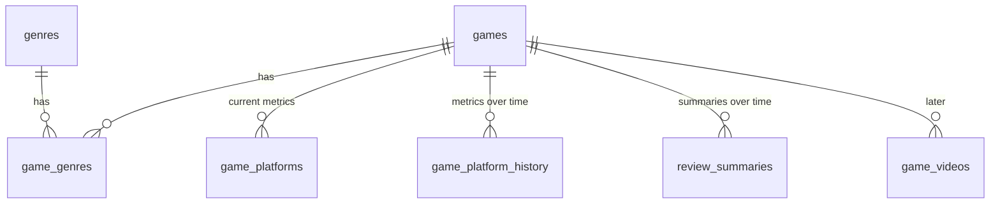

# Схема базы данных

СУБД: SQLite. Общие решения по хранению описаны в [ARCHITECTURE.md](ARCHITECTURE.md).

Принципы:
- Время хранится в UTC в формате ISO 8601 (`TEXT`).
- Сырые отзывы не хранятся, их можно восстановить с Metacritic. Остаются только резюме и хэш набора отзывов.
- Метрики и резюме версионируются: строки только добавляются, чтобы строить графики во времени.
- Актуальные значения для списка, фильтров и сортировки лежат в `game_platforms`.

## Диаграмма связей

`sync_runs` с остальными таблицами не связана внешними ключами, это журнал запусков.

## Таблицы

### `games`

Одна строка на игру, актуальные описательные данные.

| Поле | Тип | Описание |
|---|---|---|
| `id` | INTEGER PK | |
| `slug` | TEXT UNIQUE NOT NULL | идентификатор из URL Metacritic |
| `url` | TEXT NOT NULL | ссылка на страницу игры |
| `title` | TEXT NOT NULL | название |
| `cover_url` | TEXT | картинка-обложка |
| `developer` | TEXT | разработчик |
| `description` | TEXT | описание |
| `video_url` | TEXT | ссылка на видео |
| `content_hash` | TEXT | хэш описательных полей (название, обложка, разработчик, описание, видео, жанры) |
| `first_seen_at` | TEXT NOT NULL | когда игра впервые попала в базу |
| `updated_at` | TEXT NOT NULL | когда описательные поля менялись в последний раз |
| `last_processed_at` | TEXT NOT NULL | когда игра обрабатывалась в последний раз |

Индексы: `slug` (уникальный), `last_processed_at` (для пропуска игр, обработанных сегодня).

### `genres`

| Поле | Тип | Описание |
|---|---|---|
| `id` | INTEGER PK | |
| `name` | TEXT UNIQUE NOT NULL | |

### `game_genres`

| Поле | Тип | Описание |
|---|---|---|
| `game_id` | INTEGER FK → games.id | |
| `genre_id` | INTEGER FK → genres.id | |

Первичный ключ: `(game_id, genre_id)`.

### `game_platforms`

Актуальные значения по платформам.

| Поле | Тип | Описание |
|---|---|---|
| `game_id` | INTEGER FK → games.id | |
| `platform` | TEXT NOT NULL | например `ps5`, `switch-2` |
| `metascore` | INTEGER | оценка критиков, `NULL` если нет |
| `userscore` | REAL | оценка пользователей, `NULL` если нет |
| `critic_reviews_count` | INTEGER | |
| `user_reviews_count` | INTEGER | |
| `updated_at` | TEXT NOT NULL | |

Первичный ключ: `(game_id, platform)`. Индекс по `platform` для фильтра.

### `game_platform_history`

История метрик. Только добавление строк, по одной на платформу при каждом обходе.

| Поле | Тип | Описание |
|---|---|---|
| `id` | INTEGER PK | |
| `game_id` | INTEGER FK → games.id | |
| `platform` | TEXT NOT NULL | |
| `metascore` | INTEGER | |
| `userscore` | REAL | |
| `critic_reviews_count` | INTEGER | |
| `user_reviews_count` | INTEGER | |
| `captured_at` | TEXT NOT NULL | |

Индекс: `(game_id, platform, captured_at)`.

### `review_summaries`

Версии резюме по отзывам. Только добавление строк. Новая версия создаётся при смене `reviews_hash`.

| Поле | Тип | Описание |
|---|---|---|
| `id` | INTEGER PK | |
| `game_id` | INTEGER FK → games.id | |
| `source` | TEXT NOT NULL | `critics` или `users` |
| `likes` | TEXT | что нравится |
| `dislikes` | TEXT | что не нравится |
| `reviews_hash` | TEXT NOT NULL | хэш набора отзывов, по которому сделано резюме |
| `generated_at` | TEXT NOT NULL | |

Индекс: `(game_id, source, generated_at)`. Актуальное резюме — самая свежая строка по `(game_id, source)`.

### `sync_runs`

Журнал запусков обработки. Из него выводится следующая пачка игр и берутся данные для мониторинга.

| Поле | Тип | Описание |
|---|---|---|
| `id` | INTEGER PK | |
| `trigger` | TEXT NOT NULL | `schedule` или `manual` |
| `status` | TEXT NOT NULL | `running`, `success`, `failed` |
| `source` | TEXT | `new_releases` или `see_all` |
| `offset` | INTEGER | сдвиг первой игры пачки в списке SEE ALL (для `new_releases` — `NULL`) |
| `started_at` | TEXT NOT NULL | |
| `finished_at` | TEXT | |
| `games_found` | INTEGER | |
| `games_processed` | INTEGER | |
| `games_failed` | INTEGER | |
| `error` | TEXT | |

### `game_videos` (доп. часть 1, позже)

| Поле | Тип | Описание |
|---|---|---|
| `id` | INTEGER PK | |
| `game_id` | INTEGER FK → games.id | |
| `youtube_url` | TEXT NOT NULL | |
| `views` | INTEGER | |
| `transcript` | TEXT | |
| `conclusion` | TEXT | |
| `created_at` | TEXT NOT NULL | |

## Вычисляемые данные

Похожие игры отдельно не хранятся, а вычисляются на лету по общим жанрам и платформам.
